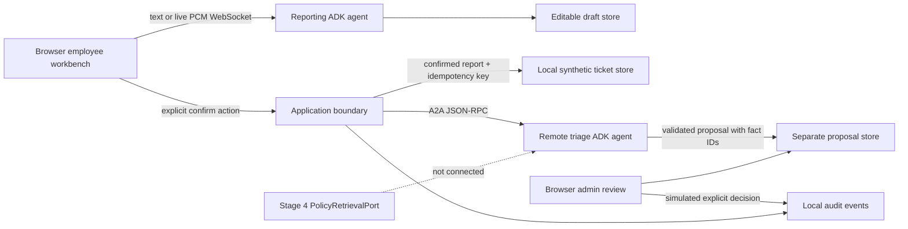

# Stage 3 Agent Architecture

Stage 3 is an isolated Python service. It does not call the Stage 1-2 API and does not modify the Flutter or React applications. The standalone workbench uses synthetic identities and SQLite fake adapters only.



## A2A Message Sequence

```mermaid
sequenceDiagram
  actor Employee
  participant Workbench as Application boundary
  participant Ticket as Fake ticket store
  participant Report as Reporting coordinator
  participant Card as A2A agent card
  participant Triage as Remote triage agent
  participant Proposal as Proposal store
  Employee->>Workbench: Explicitly confirm reviewed draft
  Workbench->>Ticket: Create confirmed ticket (idempotency key)
  Ticket-->>Workbench: Acknowledged ticket ID
  Workbench->>Report: ConfirmedReport only
  Report->>Card: Resolve /.well-known/agent-card.json
  Card-->>Report: A2A card, text modes, endpoint
  Report->>Triage: A2A task: report ID, revision, facts, language, correlation ID
  Triage-->>Report: Task result with fact-linked proposal
  Report->>Proposal: Validate references and persist separately
  Report-->>Workbench: Proposal ID, task ID, latency
  Workbench-->>Employee: Ticket success only after storage acknowledgement
  Note over Ticket,Proposal: Peer failure keeps the ticket; triage is pending and retry reuses its key.
```

## Boundary Contracts

- `ReportDraft` is never accepted by the A2A client. Only `ConfirmedReport` can be serialized. The remote ADK agent validates incoming JSON in application code before model invocation.
- The A2A payload contains structured confirmed facts, report ID/revision, language, confirmation metadata, correlation ID, and an idempotency key. Audio and device inventory are not sent.
- Each `ReportFact` identifies `employee_statement` or `consented_device_observation`. Device observations require a consent flag and timestamp. The local adapter currently returns no observations.
- Each substantive triage reason and evidence reference contains report fact IDs. The client validates IDs, report revision, severity constraints, and output schema before separate proposal persistence.
- Ticket creation requires explicit confirmation, an authenticated employee identity context, and an idempotency key in application code. The local workbench injects fixed synthetic identities; this is not authentication.
- Administrator decisions are simulated and require an administrator identity context. They do not assign teams, escalate, suspend accounts, contact parties, or close tickets.
- A failed A2A call records an audit event and pending state. Confirmed ticket content remains unchanged; retry uses the same deterministic triage key.

## Stage 4 Policy Retrieval Interface

`PolicyRetrievalPort.retrieve(PolicyRetrievalRequest)` is an intentionally unused interface. `PolicyPassage` requires source and citation identifiers. No adapter, policy corpus, citations, AlloyDB, or RAG flow is implemented in Stage 3. Triage output must not imply that company policy was checked.

## Local Services

| Port | Service | Exposure |
| --- | --- | --- |
| `8000` | Workbench UI, fake application API, and live audio WebSocket | Loopback only; not the employee app/admin API |
| `8011` | A2A triage agent and `/.well-known/agent-card.json` | Loopback only; never expose to Flutter or React |
| `3000` | Existing Stage 1-2 API | Not connected by Stage 3 |

The one-command launcher is `python -m anuvach_agents.serve` from `services/agents`. Stop both services with Ctrl+C.